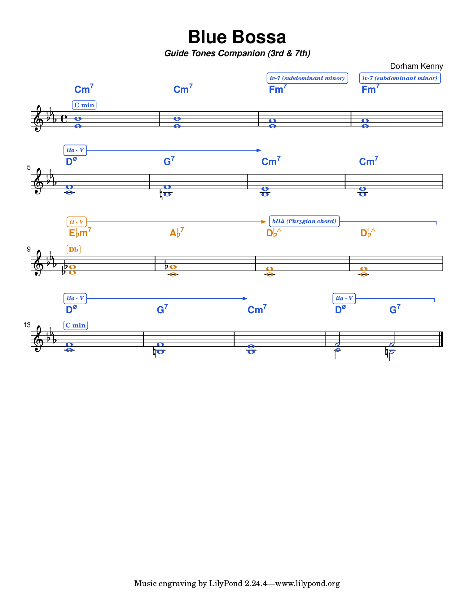
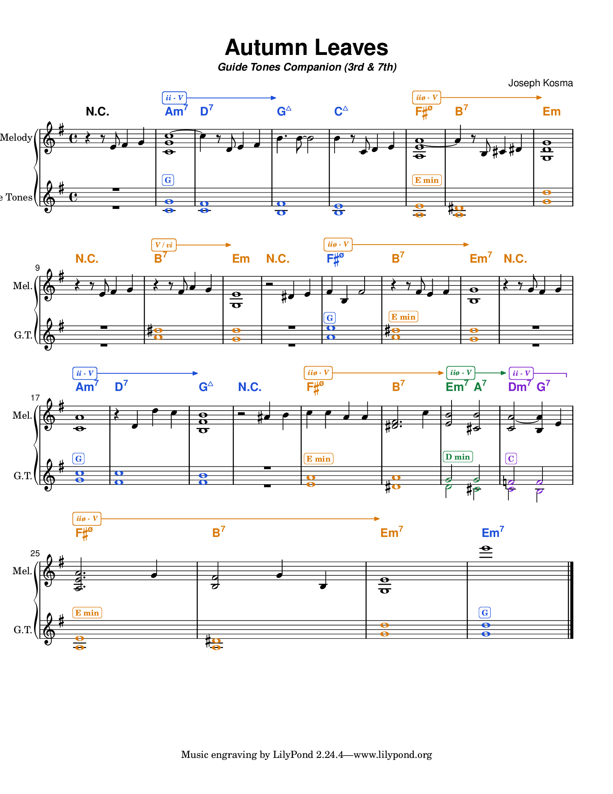
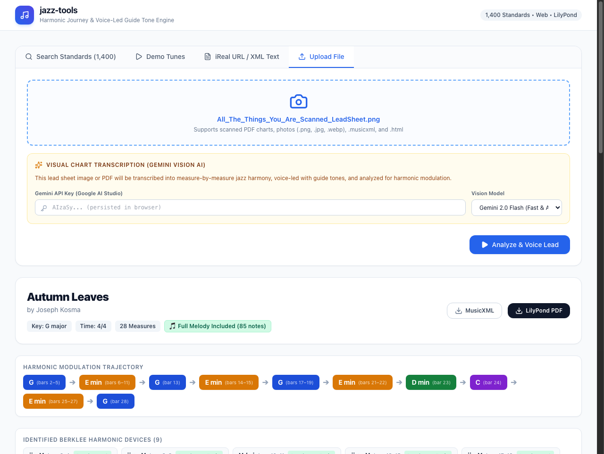
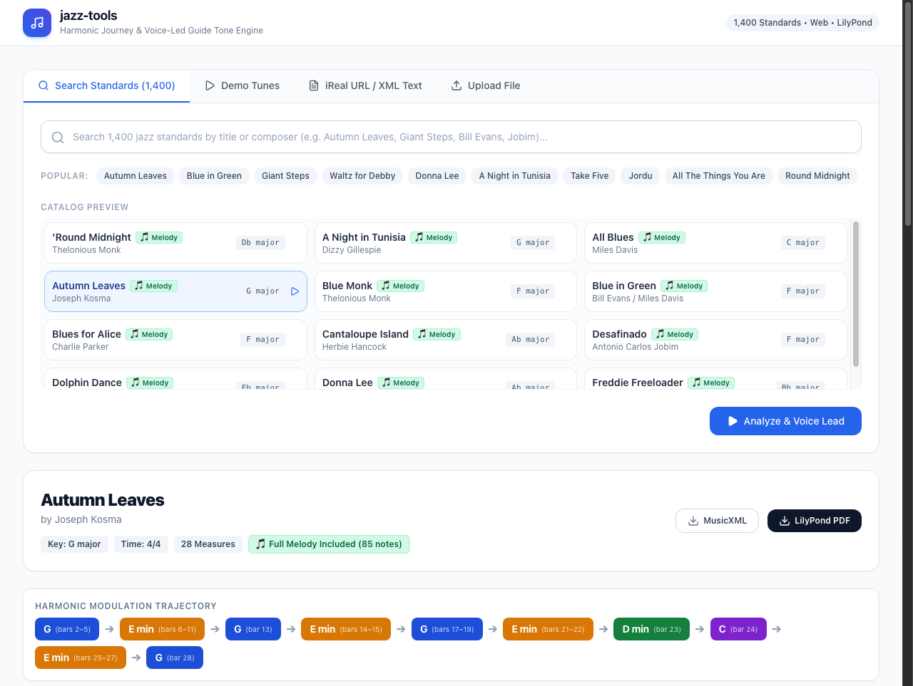

# jazz-tools

Command-line utility and jazz music theory engine to analyze jazz standards, track tonal centers and harmonic cadences, import lead sheets from **MusicXML**, **iReal Pro**, or **scanned PDFs and photos**, and generate voice-led **Guide Tone (3rd & 7th) Companion Sheets** for combo rehearsal, soloing practice, and study.

---

## Features

- **Tonal Center & Harmonic Journey Analysis**:
  - Automatically identifies local tonal centers and key modulations throughout each tune.
  - **Melody-Informed Modal Analysis**: Evaluates melody notes against minor chords to differentiate Natural Minor from **Dorian mode** and identify the underlying parent diatonic scale (e.g. $[ A \text{ dorian } (G \text{ notes}) ]$ in *Recorda Me*).
  - **Curated High-Contrast Color Palette**: Uses distinct, high-variety colors for adjacent tonal centers to ensure clear legibility on both screen and printed sheet music.
- **Berklee-Style Harmonic Device Annotations**:
  - **$\text{ii-V-I}$ / $\text{ii}^\varnothing\text{-V-i}$ Brackets & Arrows**: Solid overhead brackets spanning $\text{ii-V}$ pairs with an arrow pointing to the target resolution chord.
  - **Cadential Turnaround Hooks (`┐`)**: Terminal downward hooks for unresolved $\text{ii-V}$ cadences at phrase ends.
  - **Tritone Substitutions**: Dashed brackets and arrows for $\text{ii-subV}$ and isolated $\text{subV}$.
  - **Secondary Dominants**: Brackets and resolution arrows labeled relative to the home tonic ($\text{V/vi}$, $\text{V/ii}$, $\text{V/V}$, $\text{V/IV}$, etc.).
  - **Phrygian Chromatic Neighbors & Modal Interchange**: Automatically recognizes $\flat\text{II}\Delta$ Phrygian neighbor chords and subdominant minor / modal interchange chords ($\text{iv}-7$, $\flat\text{VI}\Delta$, $\flat\text{VII}\Delta$).
  - **Multi-Measure Dominant Spanning**: Brackets expand across consecutive identical chords.
- **Visual Lead Sheet Transcription (Scanned PDFs & Photos)**:
  - Transcribe scanned PDF charts or photos from your phone or Real Book directly into structured music data.
  - Powered by **Google Gemini Vision LLM** (`gemini-2.0-flash` or `gemini-1.5-pro`) to extract measure numbers, chord symbols, beats, and key signatures.
  - Flexible authentication with zero external dependencies: supports **Google Application Default Credentials (ADC)** (`gcloud auth application-default login`), OAuth bearer tokens (`ya29...`), and Google AI Studio keys (`AIzaSy...`).
- **Voice-Led Guide Tone Companion Generator**:
  - Voices the **3rd and 7th** of every chord on the treble staff for the exact duration of each chord hold.
  - Connects two independent polyphonic voices (Voice 1 upper stems up, Voice 2 lower stems down) via minimal motion for smooth, stepwise voice leading.
- **Smart Page Budgeting & Single-Page Guarantee**:
  - Automatically breaks lines to natural musical phrases (4 bars/system for tunes $\le 24$ bars, 8 bars/system for 32-bar standards).
  - Compact vertical spacing ensures charts fit cleanly on **exactly one page**.
- **Multi-Format Ingestion**:
  - **Visual Lead Sheets**: Scanned PDFs, PNG, JPEG, WebP.
  - **MusicXML**: Parses lead sheets from iReal Pro, MuseScore, Sibelius, or Finale.
  - **iReal Pro**: Directly imports from `irealb://` links, exported `.html` playlists, or forum chord charts.
  - **Built-in 1,400 Standards Library**: Instant search and analysis of over 1,400 jazz standards.

---

## Examples & Walkthrough

### 1. Terminal Harmonic Analysis (`jazz-tools analyze`)

Analyze any MusicXML file, iReal Pro URL, or search directly by song title from the built-in catalog of **1,400 Jazz Standards**:

```bash
# Direct title lookup from built-in 1,400 standards library:
jazz-tools analyze "Autumn Leaves"
jazz-tools analyze "Giant Steps"

# Or analyze a local file or iReal URL:
jazz-tools analyze Blue_Bossa.musicxml
```

**Output snippet:**
```text
=============================================================================================
Tune: Blue Bossa by Dorham Kenny
Key: C minor | Time Signature: 4/4 | Measures: 16
---------------------------------------------------------------------------------------------
Measure | Beat | Chord         | Hold (beats) | Voice 1 (3/7) | Voice 2 (3/7) | Tonal Center
--------+------+---------------+--------------+---------------+---------------+-------------
     1  |  1.0 | Cm7           |          4.0 | Bb4           | Eb4           | C min      
     2  |  1.0 | Cm7           |          4.0 | Bb4           | Eb4           | C min      
     3  |  1.0 | Fm7           |          4.0 | Ab4           | Eb4           | C min      
     4  |  1.0 | Fm7           |          4.0 | Ab4           | Eb4           | C min      
     5  |  1.0 | Dø            |          4.0 | F4            | C4            | C min      
     6  |  1.0 | G7b9          |          4.0 | F4            | B3            | C min      
     7  |  1.0 | Cm7           |          4.0 | Eb4           | Bb3           | C min      
     8  |  1.0 | Cm7           |          4.0 | Eb4           | Bb3           | C min      
     9  |  1.0 | Ebm7          |          4.0 | Gb4           | Db4           | Db         
    10  |  1.0 | Ab7           |          4.0 | Gb4           | C4            | Db         
    11  |  1.0 | Db^7          |          4.0 | F4            | C4            | Db         
    12  |  1.0 | Db^7          |          4.0 | F4            | C4            | Db         
    13  |  1.0 | Dø            |          4.0 | F4            | C4            | C min      
    14  |  1.0 | G7b9          |          4.0 | F4            | B3            | C min      
    15  |  1.0 | Cm7           |          4.0 | Eb4           | Bb3           | C min      
    16  |  1.0 | Dø            |          2.0 | F4            | C4            | C min      
    16  |  3.0 | G7b9          |          2.0 | F4            | B3            | C min      
---------------------------------------------------------------------------------------------
Harmonic Journey:
  [ C min ] (bars 1-8) ➔ [ Db ] (bars 9-12) ➔ [ C min ] (bars 13-16)
=============================================================================================
```

---

### 2. Print-Ready Companion Sheets (`jazz-tools companion`)

Generate an annotated companion sheet complete with voice-led guide tones, tonal key badges, and Berklee brackets:

```bash
# Generate both MusicXML and publication-ready LilyPond PDF:
jazz-tools companion Blue_Bossa.musicxml --pdf

# Include tonal center key badges:
jazz-tools companion Autumn_Leaves.musicxml --pdf --keys

# Generate directly from an iReal Pro URL or playlist:
jazz-tools companion "irealb://..." --pdf
jazz-tools companion "MySetlist.html" --pdf
```

#### Example Output: *Blue Bossa*
- **Bars 3–4**: Subdominant minor label over $\text{Fm}^7$.
- **Bars 5–7**: Minor $\text{ii}^\varnothing\text{-V}$ bracket over $\text{D}^\varnothing \rightarrow \text{G}^7$ with arrow pointing to $\text{Cm}^7$.
- **Bars 9–11**: Major $\text{ii-V}$ bracket in $\text{D}\flat$ resolving to $\text{D}\flat^{\Delta 7}$, annotated with $\flat\text{II}\Delta$ Phrygian modal chord.
- **Bar 16**: Cadential turnaround hook (`┐`) over unresolved $\text{D}^\varnothing \rightarrow \text{G}^7$.

<p align="center">
  
</p>

#### Example Output: *Autumn Leaves*
- **Bars 1–3**: Major $\text{ii-V-I}$ bracket in $\text{G}$.
- **Bars 5–7**: Minor $\text{ii}^\varnothing\text{-V-i}$ bracket in $\text{E minor}$.
- **Bars 10–11**: Secondary dominant $\text{V/vi}$ resolving to $\text{Em}$.
- **Tonal Center Badges**: Distinct high-contrast colors indicating modulations to $\text{G}$, $\text{E min}$, $\text{D min}$, and $\text{C}$.

<p align="center">
  
</p>

---

### 3. Visual Lead Sheet Transcription (`jazz-tools transcribe`)

Transcribe scanned PDFs or smartphone photos of lead sheets directly into MusicXML and companion scores:

```bash
# Transcribe an image or scanned PDF into MusicXML and PDF:
jazz-tools transcribe chart.png --pdf -o my_chart.musicxml

# Directly passing an image or PDF auto-detects visual transcription mode:
jazz-tools chart.pdf
```

#### Authentication Options:
- **Application Default Credentials (ADC)** *(Recommended)*: If you use the Google Cloud CLI, run `gcloud auth application-default login` or set `export GOOGLE_APPLICATION_CREDENTIALS=/path/to/key.json`. `jazz-tools` automatically handles token refreshes without requiring any API key.
- **Direct OAuth Token**: Pass an access token (`ya29...`) via `--api-key` or paste it directly in the web UI.
- **Google AI Studio Key**: Get a free API key at [Google AI Studio](https://aistudio.google.com/app/apikey) and provide it via `--api-key` or `export GEMINI_API_KEY=AIzaSy...`.

<p align="center">
  
</p>

---

### 4. Interactive Web Interface (`jazz-tools serve`)

Launch the built-in web interface and REST API server:

```bash
jazz-tools serve --port 8080
```

Open [http://localhost:8080](http://localhost:8080) in your browser:

- **Instant Search across 1,400 Jazz Standards**: Search by song title or composer (e.g. *Giant Steps*, *Autumn Leaves*, *Bill Evans*) with real-time autocompletion and one-click loading.
- **Visual Chart Upload Dropzone**: Drag and drop any PDF or photo of a lead sheet to transcribe and analyze it automatically.
- **Harmonic Modulation Trajectory**: Visual timeline of key changes rendered in a curated, high-contrast palette.
- **Identified Berklee Harmonic Devices**: Detailed breakdown of $\text{ii-V-I}$ cadences, secondary dominants, and turnaround hooks.
- **Interactive Notation & Exports**: Toggle between vector SVG and OpenSheetMusicDisplay, and download companion MusicXML or print-ready LilyPond PDFs with one click.

<p align="center">
  
</p>

---

### 5. Annotation Controls & Options

Fine-tune annotations according to your rehearsal or pedagogical needs:

```bash
# Default: Berklee harmonic devices (ii-V brackets & arrows) enabled:
jazz-tools companion Autumn_Leaves.musicxml --pdf

# Also include tonal center key badges:
jazz-tools companion Autumn_Leaves.musicxml --pdf --keys
# or:
jazz-tools companion Autumn_Leaves.musicxml --pdf --annotations all

# Clean score with only chords and guide tones (no annotations):
jazz-tools companion Autumn_Leaves.musicxml --pdf --annotations none

# Manually override measures per system (e.g. 4 bars per line):
jazz-tools companion Autumn_Leaves.musicxml --pdf --bars 4
```

---

## Installation & Requirements

Ensure you have [Go](https://go.dev) (1.21+) installed.

To compile PDFs directly, install [LilyPond](https://lilypond.org):
```bash
# macOS (Homebrew)
brew install lilypond

# Ubuntu / Debian
sudo apt-get install lilypond
```

Build the self-contained binary (includes the embedded web interface):
```bash
go build -o jazz-tools ./cmd/jazz-tools
```

---

## Running Tests

Run the full test suite covering pitch class math, chord qualities, voice leading, MusicXML read/write, harmonic device detection, ADC token resolution, and iReal Pro deobfuscation:

```bash
go test -v ./...
```
